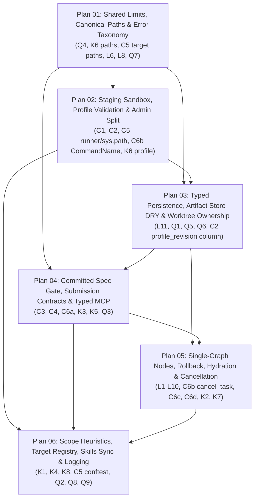

# SDD Engine Audit: Fact-Check & Dependency Analysis

Status: done (fact-check and dependency analysis complete — start implementation at [`01-limits-paths-and-errors.md`](01-limits-paths-and-errors.md))

This document fact-checks every finding (`C1–C6`, `L1–L11`, `K1–K8`, `Q1–Q9`) and recommendation (`1–22`) in [`sdd_engine/sdd-audit.md`](../sdd-audit.md) against the repository at `cb3afce`, highlights critical technical corrections and hidden dependencies discovered during verification, and defines the dependency-ordered execution plans (`01`–`06`) in `sdd_engine/plans/`.

---

## 1. Key Corrections & Nuances Discovered During Fact-Checking

While all 29 underlying defects in `sdd-audit.md` are **confirmed in the code**, 8 of the audit's proposed fixes in Section 4 have nontrivial interactions or would break existing invariants/tests if applied verbatim:

1. **Rootless Docker vs. `USER` in Dockerfiles (Audit Phase 0.2 & L8)**
   - **Audit proposal**: *"Pass `--user {uid}:{gid}` unless Docker is detected as rootless, and add `USER` to the three Dockerfiles."*
   - **Correction**: Adding a non-root `USER` (e.g. `USER 1000:1000`) to [`toolchains/python.Dockerfile`](../../toolchains/python.Dockerfile), [`toolchains/rust.Dockerfile`](../../toolchains/rust.Dockerfile), and [`toolchains/go.Dockerfile`](../../toolchains/go.Dockerfile) **breaks rootless Docker** (which is the mandatory workstation setup per [`roadmap.md:18-20`](../../roadmap.md#L18-L20)). Under rootless Docker, container UID `0` (`root`) maps to the host user (`os.getuid()`), whereas container UID `1000` maps to an unprivileged subordinate UID (e.g. `100999`). A non-root `USER` inside rootless Docker cannot traverse a `0700` `tempfile.TemporaryDirectory` staging directory owned by container UID `0`, writes files owned by host subuid `100999`, and breaks [`tests/test_docker_integration.py:72-80`](../../tests/test_docker_integration.py#L72-L80) (`test_workspace_writes_are_owned_by_the_host_user`).
   - **Resolution (Plan 02)**: Keep container user as `0:0` under rootless Docker (where container `0:0` == host UID/GID), pass `--user {os.getuid()}:{os.getgid()}` only when the daemon is rootful (auto-detected via `docker info` security options or explicit runner configuration), and stage the worktree into a temporary directory so container writes never touch the host worktree.

2. **`ImageRef` Digest Pattern vs. Existing Test Fixtures (Audit C2 & Phase 0.3)**
   - **Audit proposal**: `ImageRef` regex requiring `sha256:...` or `...@sha256:...`.
   - **Correction**: Requiring a SHA-256 digest on every `ValidationProfile.image` immediately breaks [`tests/test_graph.py:47`](../../tests/test_graph.py#L47) (`"busybox:1.37"`), [`tests/test_validation.py:24`](../../tests/test_validation.py#L24) (`"toolchain:pinned"`), and [`tests/test_docker_integration.py:24-26`](../../tests/test_docker_integration.py#L24-L26) (`"busybox:1.37"`, `"golang:1.26-alpine"`, `"sdd-engine-test/missing:never"`).
   - **Resolution (Plan 02)**:
     1. Reject leading dashes and invalid characters with a strict OCI reference regex (`^(?:sha256:[0-9a-f]{64}|[a-z0-9][a-z0-9._/-]*(?::[a-zA-Z0-9_.-]+)?(?:@sha256:[0-9a-f]{64})?)$`) so `--privileged` or option injection is impossible at the model level.
     2. Insert `"--"` before `profile.image` in [`DockerCommandRunner.run`](../validation.py#L149) as defense-in-depth so `docker run` never parses the image argument as a flag.

3. **Typing `submit` on FastMCP vs. In-Graph Contract Retry Accounting (Audit C4 & Phase 1.4)**
   - **Audit proposal**: Annotate `submit(..., submission: GenerationOutput)` directly on the FastMCP tool in [`mcp_server.py`](../mcp_server.py).
   - **Correction**: FastMCP validates Pydantic parameters *before* calling the tool body. Because [`GenerationOutput`](../models.py#L184-L224) carries semantic `@field_validator`s (`require_documentation_sections`, `require_error_mapping`, `require_unique_files`, plus byte-size caps), validating `GenerationOutput` at the FastMCP boundary would raise `ValidationError` before `service.submit` / `SddEngine.submit` runs. That would bypass the graph's contract check (`graph.py:240-258`), never increment `generation_attempts` or `generation_failures`, never persist a `FailureReport(category="generation_contract")`, and break [`tests/test_graph.py:95-105`](../../tests/test_graph.py#L95-L105) (`test_bad_submission_retries_with_contract_feedback`).
   - **Resolution (Plan 04)**: Expose a structural `SubmissionPayload` (`TypedDict` or unvalidated schema model) on the MCP tool signature so FastMCP publishes the exact JSON Schema (`files`, `documentation_metadata`, `error_handling_mapping`), and include `submission_schema` inside `GenerationPrompt`, while keeping `GenerationOutput.model_validate(...)` inside the graph's `check_contract` node so contract failures are recorded and counted against the retry budget.

4. **Reconciling Graph `rollback` and `finish_task` `restore_tree` Affects Existing Scope-Report Test (Audit L7 & Q6)**
   - **Audit proposal**: Reconcile the graph's `rollback` node (`graph.py:187-217`) and `finish_task`'s `restore_tree` (`service.py:175-181`).
   - **Correction**: Currently, when a run fails in [`tests/test_graph.py:107-126`](../../tests/test_graph.py#L107-L126) (`test_failed_run_restores_agent_edits`), the graph's `rollback` node deletes `TARGET_FILE` *before* `finish_task` captures `finish_tree`, which is why line 121 asserts `report["scope_report"]["changes"] == [{"path": "rogue.py", ...}]` (missing `TARGET_FILE`). Also, in [`tests/test_graph.py:128-154`](../../tests/test_graph.py#L128-L154) (`test_head_move_refuses_broader_rollback`), `finish_task` refuses `restore_tree` when `HEAD` moved, yet the graph's `rollback` node already reverted `TARGET_FILE`!
   - **Resolution (Plan 05)**: When running through `service.py`, capture `finish_tree` and `scope_report` **before** rolling back, or have `finish_task` / `cancel_task` perform the unified rollback (`restore_tree` for tracked/untracked files + `OriginalFile` snapshot restoration for gitignored target files, gated on `head == original_head`), and update `test_failed_run_restores_agent_edits` so `scope_report["changes"]` accurately includes both `pkg/module.py` (`declared`) and `rogue.py` (`undeclared`).

5. **Binding `begin_task` to Committed Spec vs. Templates and Existing Tests (Audit C3 & Phase 1.5)**
   - **Audit proposal**: Replace `begin_task(spec=...)` with `begin_task(spec_path=...)` reading from `HEAD` and parsing `Target files:` from the spec header.
   - **Correction**:
     1. None of [`task.simple.template.md`](../../skills/sdd-shared/templates/task.simple.template.md), [`task.saas.template.md`](../../skills/sdd-shared/templates/task.saas.template.md), [`task.game.template.md`](../../skills/sdd-shared/templates/task.game.template.md), or [`task.spec.template.md`](../../skills/sdd-shared/templates/task.spec.template.md) currently have a `Target files:` header line.
     2. All 11 tests in [`tests/test_graph.py`](../../tests/test_graph.py) pass inline `spec` text and `target_files` without committing a spec file to `HEAD`.
   - **Resolution (Plan 04 & Plan 06)**: Add `Target files:` to the task templates (and mirror to `/home/htxzz77/Projects/skills/`), enforce `Status: ready` in the spec header block (`spec_text.split("\n## ", 1)[0]`), support `spec_path` verification against `HEAD` (recording `spec_path` and `spec_blob` in `runs` and deriving `target_files` from the `Target files:` header when `target_files` is omitted or verifying they match when supplied), and update `tests/test_graph.py` fixtures accordingly.

6. **Legacy `skills/sdd-implement/` and `templates/` vs. `README.md:19` (Audit K4 & Phase 3.20)**
   - **Audit proposal**: Move `skills/sdd-implement` and top-level `templates/` into `legacy/`.
   - **Correction**: Root [`README.md:19`](../../README.md#L19) explicitly documents: *"The older `skills/sdd-implement/` and top-level `templates/` remain in the tree for existing users. New installations should use the twelve tiered skills and their `sdd-shared` sibling directory."* Also, `/home/htxzz77/Projects/skills/` does **not** contain `sdd-implement`, and the install script in `README.md:48-56` only copies the 12 tiered skills + `sdd-shared`.
   - **Resolution (Plan 06)**: Either move `skills/sdd-implement/` and top-level `templates/` to `legacy/` **and** update `README.md:19`, or add a prominent deprecation header in `skills/sdd-implement/SKILL.md` pointing to `sdd-implement-{simple,saas,game}`. Tracked as an explicit decision in Plan 06.

7. **Synchronous vs. Asynchronous `submit` (Audit C6d & Phase 2.16)**
   - **Audit proposal**: Make `submit` return `awaiting_validation` and poll `get_run_report`, or send MCP progress notifications.
   - **Correction**: Changing `submit` to return `awaiting_validation` by default breaks synchronous callers and every `submit` test in `tests/test_graph.py`.
   - **Resolution (Plan 05)**: Lower default `ValidationProfile.timeout_seconds` from `600` to a safer default (e.g. `120`s, still configurable up to `3600`s) and support MCP progress notifications / optional non-blocking execution without breaking the synchronous `submit` contract used by existing tests and agents.

8. **Untested Graph Paths Were Partially Present in `b94811c` (Audit Q8)**
   - **Audit claim**: Hydration failure, validation-infrastructure failure inside the graph, failing rollback node, and exhausted generation budget have no tests.
   - **Correction**: Those tests existed in commit `b94811c` and were removed when `cb3afce` rewrote `tests/test_graph.py` around `service.py`. Extracting module-level node functions in Plan 05 and restoring direct unit tests in Plan 05/06 recovers full coverage without needing SQLite or Git setup for node-level tests.

---

## 2. Complete Fact-Check Matrix of Audit Findings

| ID | Severity | Audit Claim | Verification Status & Code Evidence | Assigned Plan |
| --- | --- | --- | --- | --- |
| **C1** | Critical | Container bind-mounts worktree RW, allowing writes to `.git/hooks/*`, `.git/config`, `.git` worktree pointer, and `.git/spec-tech/engine.db`. | **Confirmed.** [`validation.py:145-146`](../validation.py#L145-L146) mounts `workspace_root` RW at `/workspace`; [`store.py:44`](../store.py#L44) puts `engine.db` in `.git/spec-tech/`; [`scope.py:52-53`](../scope.py#L52-L53) runs host `git add -A` in `finish_task`. | **Plan 02** |
| **C2** | Critical | Admin/implementer split is convention only: `cli.py:23` exposes `configure_profile`, runs don't record `profile_revision`, and `ValidationProfile.image` (`validation.py:64,149`) accepts `"--privileged"`. | **Confirmed.** [`cli.py:18-25`](../cli.py#L18-L25) has no `--admin` gate; [`store.py:85-100`](../store.py#L85-L100) `runs` table lacks `profile_revision`/`profile_digest`; [`validation.py:64,149`](../validation.py#L64) does not validate `image` or pass `--`. | **Plan 02**, **Plan 03** |
| **C3** | High | Engine accepts free-text `spec` and caller-chosen `target_files`; `_BLOCKED_SPEC` (`service.py:30`) allows `Status: draft`, unfilled template, or missing status, and rejects ready specs with indented `status: blocked`. | **Confirmed.** [`service.py:30,74-88`](../service.py#L30) only checks `_BLOCKED_SPEC.search(spec)` across the entire body. | **Plan 04** |
| **C4** | High | MCP schemas (`mcp_server.py:16-33`) expose `tier: str`, `target: str`, `files: dict[str, object]`, and `GenerationPrompt` (`models.py:226`) omits the `GenerationOutput` schema. | **Confirmed.** [`mcp_server.py:16-44`](../mcp_server.py#L16-L44) and [`models.py:226-241`](../models.py#L226-L241). | **Plan 04** |
| **C5** | High | Profiles run gitignored `node_modules/.bin/*` and `cmake --build build` (`validation.py:267-293`), accept them in `target_files`, run `python -m ruff\|mypy\|pytest` with `/workspace` on `sys.path[0]`, and miss root `conftest.py` in `scope.py`. | **Confirmed.** [`validation.py:257-305`](../validation.py#L257-L305), [`models.py:79-86`](../models.py#L79-L86), [`scope.py:22-28,53`](../scope.py#L22-L28). | **Plan 01**, **Plan 02**, **Plan 06** |
| **C6a** | High | Unbounded `WorkspaceFile.content` (`models.py:181`) writes >4 MB files to disk (`graph.py:269`), then fails terminally in `validate` at the 4 MB read limit (`graph.py:304`) with `artifact_contract` instead of retryable `generation_contract`. | **Confirmed.** [`models.py:177-182`](../models.py#L177-L182), [`graph.py:269,281,303-312`](../graph.py#L269). | **Plan 01**, **Plan 04** |
| **C6b** | High | No `cancel_task` operation; abandoned run or uncaught exception in `submit` (e.g. `CommandSpec.name` > 128 chars crashing `CommandResult` at `models.py:259`) permanently blocks the worktree via `runs_active_workspace`. | **Confirmed.** [`store.py:116-117,225-226`](../store.py#L116-L117), [`service.py:116-136`](../service.py#L116-L136), [`validation.py:45`](../validation.py#L45) vs [`models.py:259`](../models.py#L259). | **Plan 02**, **Plan 05** |
| **C6c** | High | `PromptHydrator` loads skills from `Path(__file__).resolve().parents[1] / "skills"` (`service.py:54`, `guidance.py:114`), which is absent from wheels (`pyproject.toml:26`), and raises unmapped `FileNotFoundError`. | **Confirmed.** [`pyproject.toml:25-26`](../../pyproject.toml#L25-L26), [`service.py:54`](../service.py#L54), [`guidance.py:112-123`](../guidance.py#L112-L123), [`graph.py:223`](../graph.py#L223). | **Plan 05** |
| **C6d** | High | `submit` executes all validation commands synchronously (up to 600s per command, `validation.py:66`), risking MCP client timeouts. | **Confirmed.** [`validation.py:66`](../validation.py#L66), [`service.py:124`](../service.py#L124). | **Plan 05** |
| **L1** | Medium | `generate` node (`graph.py:219-290`) mixes hydration, `interrupt()`, contract validation, snapshotting, file writes, and persistence; LangGraph re-runs `hydrate()` on every `submit` resume. | **Confirmed.** [`graph.py:219-290`](../graph.py#L219-L290). | **Plan 05** |
| **L2** | Medium | `build_graph` (`graph.py:92-96`) compiles 18 target subgraphs on every MCP call even though `_engine` (`service.py:55`) only configures one target and `state.target` is already in `GraphState`. | **Confirmed.** [`graph.py:84-105,159-162`](../graph.py#L84-L105), [`service.py:43-57`](../service.py#L43-L57). | **Plan 05** |
| **L3** | Medium | `max_generation_attempts` bounds consecutive `generation_failures` per round (`graph.py:233-238`), so total implementer prompts can reach `max_generation_attempts * max_validation_attempts` (9). | **Confirmed.** [`graph.py:73-74,231-238,287`](../graph.py#L231-L238). | **Plan 05** |
| **L4** | Low | `GraphPatch` (`models.py:287-299`) makes non-nullable state fields optional `None`, and `GraphPatch.model_validate(patch)` (`graph.py:425`) is a no-op on an existing `GraphPatch` instance. | **Confirmed.** [`models.py:287-299`](../models.py#L287-L299), [`graph.py:423-428`](../graph.py#L423-L428). | **Plan 05** |
| **L5** | Low | `RouteDecision` (`models.py:302-305`) regex-validates hardcoded route strings (`graph.py:373-405`) instead of using static `Literal` return types. | **Confirmed.** [`models.py:302-305`](../models.py#L302-L305), [`graph.py:373-405`](../graph.py#L373-L405). | **Plan 05** |
| **L6** | Low | `_step` (`graph.py:141-150`) wraps both `workspaces.lock()` and `graph.invoke()` in one `try`, relabeling any `ArtifactError` as `"the workspace could not be locked"` and flattening `WorkspaceBusyError`. | **Confirmed.** [`graph.py:141-150`](../graph.py#L141-L150). | **Plan 01**, **Plan 05** |
| **L7** | Medium | Graph `rollback` (`graph.py:187-217`) reverts `target_files` before `finish_task` (`service.py:165-181`) builds `finish_tree`, hiding `target_files` changes from `scope_report` on failed runs and ignoring `HEAD` movement. | **Confirmed.** [`graph.py:187-217`](../graph.py#L187-L217), [`service.py:165-181`](../service.py#L165-L181). | **Plan 05** |
| **L8** | Medium | `restore_tree` (`scope.py:128-170`) raises unmapped `OSError`, while `finish_task` (`service.py:179`) catches only `ArtifactError`, leaving failed runs stuck in `terminal` phase on `OSError`. | **Confirmed.** [`scope.py:128-170`](../scope.py#L128-L170), [`service.py:175-182`](../service.py#L175-L182). | **Plan 01**, **Plan 05** |
| **L9** | Low | `WorkspaceRegistry.lock` docstring (`artifacts.py:164`) says "for the duration of one run" (actually per step), and `submit` checks `row["phase"]` outside the lock (`service.py:118-126`). | **Confirmed.** [`artifacts.py:163-168`](../artifacts.py#L163-L168), [`service.py:118-126`](../service.py#L118-L126). | **Plan 05** |
| **L10** | Medium | `PromptHydrator.hydrate` (`guidance.py:83-96`) loads `existing_files` before `validation_feedback` and `generation_feedback`, allowing large target files to exhaust the 2 MB budget on repair rounds. | **Confirmed.** [`guidance.py:83-96`](../guidance.py#L83-L96). | **Plan 05** |
| **L11** | Medium | `_run_store` (`service.py:38-40`) resolves the shared database from `workspace` without verifying `row["workspace"] == root`, allowing a sibling worktree path to drive another worktree's run. | **Confirmed.** [`service.py:38-40,118-126,158-163,188`](../service.py#L38-L40). | **Plan 03** |
| **K1** | High | `sdd-implement-{simple,saas,game}/SKILL.md` line 9 mentions `begin_task`, `submit`, and `finish_task` without defining target selection, submission schema, failure categories, or rollback error handling. | **Confirmed.** [`skills/sdd-implement-simple/SKILL.md:9`](../../skills/sdd-implement-simple/SKILL.md#L9), [`sdd-implement-saas/SKILL.md:9`](../../skills/sdd-implement-saas/SKILL.md#L9), [`sdd-implement-game/SKILL.md:9`](../../skills/sdd-implement-game/SKILL.md#L9). | **Plan 06** |
| **K2** | Medium | `guidance.py:73` injects `sdd-implement-<tier>/SKILL.md` into `engineering_guidance`, telling the interrupted worker to make git commits, run checks, and call `begin_task`. | **Confirmed.** [`guidance.py:73`](../guidance.py#L73). | **Plan 05** |
| **K3** | Medium | `documentation_metadata` (`models.py:214`) treats `@returns` as an errors section and accepts `"Args: Raises:"`; `error_handling_mapping` (`models.py:197`) rejects empty tuples even when a change has no failure paths; `files` partial/whole-file semantics are undocumented. | **Confirmed.** [`models.py:191-224`](../models.py#L191-L224), [`tests/test_models.py:64`](../../tests/test_models.py#L64). | **Plan 04** |
| **K4** | Medium | Legacy `skills/sdd-implement/SKILL.md` and top-level `templates/` duplicate/contradict the active tiered skills (note: kept intentionally per `README.md:19`). | **Confirmed with nuance.** [`skills/sdd-implement/SKILL.md`](../../skills/sdd-implement/SKILL.md), [`README.md:19`](../../README.md#L19). | **Plan 06** |
| **K5** | Low | Status vocabulary drift across templates (`draft \| ready \| blocked`), legacy skill (`draft \| locked`), and `service.py:30` (checks only `blocked`). | **Confirmed.** [`service.py:30`](../service.py#L30), [`task.simple.template.md:3`](../../skills/sdd-shared/templates/task.simple.template.md#L3). | **Plan 04** |
| **K6** | Medium | Path validators (`models.py:79-86`, `artifacts.py:276-290`, `scope.py:118-125`) are duplicated, don't normalize `src/./x.py` or `src//x.py`, miss `.GIT` case-folding and NUL/control chars; `ValidationProfile` fields lack strict patterns; `--mount` interpolates unescaped paths. | **Confirmed.** [`models.py:79-94`](../models.py#L79-L94), [`artifacts.py:276-290`](../artifacts.py#L276-L290), [`scope.py:118-125`](../scope.py#L118-L125), [`validation.py:45,64,67,146`](../validation.py#L45). | **Plan 01**, **Plan 02** |
| **K7** | Low/Med | Untrusted workspace file contents, context, and command stdout/stderr enter `GenerationPrompt` without trust-boundary metadata. | **Confirmed.** [`models.py:226-241`](../models.py#L226-L241), [`graph.py:437-445`](../graph.py#L437-L445). | **Plan 05** |
| **K8** | Medium | `scope.py:14-28` misses `conftest.py`, `setup.cfg`, `tox.ini`, `noxfile.py`, `jest.config.*`, `vitest.config.*`, `.cargo/config.toml`, `clippy.toml`, `.golangci.yml`, `@ts-expect-error`, `@ts-nocheck`, `//nolint`, `#![allow(...)]`, `pyright: ignore`, `pylint: disable`, `pytest.mark.xfail`, `xit(`, `DISABLED_`. | **Confirmed.** [`scope.py:14-28`](../scope.py#L14-L28). | **Plan 06** |
| **Q1** | Medium | `ProjectStore` (`store.py:162-212`) duplicates `FileArtifactStore` (`artifacts.py:59-126`), which is only used in `tests/test_artifacts.py`; `import hashlib` is inside methods (`store.py:164,176`). | **Confirmed.** [`store.py:162-212`](../store.py#L162-L212), [`artifacts.py:59-126`](../artifacts.py#L59-L126). | **Plan 03** |
| **Q2** | Medium | `Target` (`models.py:32`), `TARGET_SKILLS` (`guidance.py:16`), and `standard_commands` (`validation.py:239`) are maintained separately with no sync check. | **Confirmed.** [`models.py:32-53`](../models.py#L32-L53), [`guidance.py:16-35`](../guidance.py#L16-L35), [`validation.py:239-313`](../validation.py#L239-L313). | **Plan 06** |
| **Q3** | Low | `GraphInput` and `GraphState` repeat fields (`models.py:130-175`), and `CHECKPOINT_TYPES` module/name pairs are built twice (`graph.py:61,102`). | **Confirmed.** [`models.py:130-175`](../models.py#L130-L175), [`graph.py:55-62,101-103`](../graph.py#L55-L62). | **Plan 04**, **Plan 05** |
| **Q4** | Medium | Byte/char limits (`16_000`, `16_000_000`, `4_000_000`, `2_000_000`, `1_000_000`) are inline magic numbers across 5 modules. | **Confirmed.** [`models.py:248,253,261-262`](../models.py#L248), [`validation.py:71`](../validation.py#L71), [`graph.py:52,169,304,445`](../graph.py#L52), [`guidance.py:46`](../guidance.py#L46), [`service.py:205,209`](../service.py#L205). | **Plan 01** |
| **Q5** | Medium | Run phases (`pending`/`terminal`/`finished`) have no `StrEnum`, `ProjectStore.run` returns `dict[str, object]`, and `ProjectStore` mixes migrations, profiles, artifacts, runs, and snapshots. | **Confirmed.** [`store.py:49-254`](../store.py#L49-L254), [`service.py:118-211`](../service.py#L118-L211). | **Plan 03** |
| **Q6** | Low | `snapshots` table (`store.py:101-106`), `target_entities` (`models.py:140`), and `standard_commands` (`validation.py:239`) are dead or unreachable from the service API. | **Confirmed.** [`store.py:101-106,248-254`](../store.py#L101-L106), [`models.py:140`](../models.py#L140), [`validation.py:239`](../validation.py#L239). | **Plan 03**, **Plan 05** |
| **Q7** | Low | `workspace_id=run_id` (`service.py:96,125`) is confusing, and `ArtifactError` is overloaded for Git, lock, run-lookup, profile, and storage errors. | **Confirmed.** [`service.py:96,125`](../service.py#L96), [`artifacts.py:23`](../artifacts.py#L23). | **Plan 01**, **Plan 03**, **Plan 05** |
| **Q8** | Medium | Graph nodes are closures inside `_build_specialist_subgraph` (`graph.py:159-370`) and several error/edge paths lack unit tests. | **Confirmed.** [`graph.py:159-370`](../graph.py#L159-L370), [`tests/test_graph.py`](../../tests/test_graph.py). | **Plan 05**, **Plan 06** |
| **Q9** | Medium | `sdd_engine` has no structured logging for node transitions, attempts, durations, or failures. | **Confirmed.** No `logging` imports in `sdd_engine/`. | **Plan 06** |

---

## 3. Dependency Graph & Execution Order

### Plan Files Summary

| Order | Plan File | Primary Outcome | Depends On | Fixes |
| --- | --- | --- | --- | --- |
| **1** | [`01-limits-paths-and-errors.md`](01-limits-paths-and-errors.md) | Single `limits.py`, unified `canonical_relative_path()` blocking `.git`/control chars/tool dirs, and domain `EngineError` hierarchy with MCP error formatting. | None | `Q4`, `K6` (paths), `C5` (target paths), `L6`, `L8` (error types), `Q7` |
| **2** | [`02-sandbox-and-profile-hardening.md`](02-sandbox-and-profile-hardening.md) | Stage worktree without `.git` before Docker mount, validate `ImageRef`/`CommandName`/`MemoryLimit`, add `--` before image, handle rootless vs rootful `--user`, add `--admin` gate to `cli.py`, and run `python -P -m ruff\|mypy`. | Plan 01 | `C1`, `C2` (profile/CLI/runner), `C5` (runner/sys.path), `C6b` (`CommandName`), `K6` (profile) |
| **3** | [`03-store-and-worktree-isolation.md`](03-store-and-worktree-isolation.md) | Enforce worktree ownership in `_run_store`, record & verify `profile_revision`/`profile_digest` per run, introduce `RunPhase` & typed `RunRecord`, deduplicate `ArtifactStore`, and wire `standard_commands` into `configure_profile`. | Plan 01, Plan 02 | `L11`, `C2` (revision tracking), `Q1`, `Q5`, `Q6` |
| **4** | [`04-spec-and-submission-contracts.md`](04-spec-and-submission-contracts.md) | Require `Status: ready` in the spec header block, bind runs to committed specs and `Target files:`, cap submission bytes pre-write, fix `documentation_metadata` and `error_handling_mapping`, and type MCP schemas + `GenerationPrompt.submission_schema`. | Plan 01, Plan 03 | `C3`, `C4`, `C6a`, `K3`, `K5`, `Q3` |
| **5** | [`05-graph-flow-and-lifecycle.md`](05-graph-flow-and-lifecycle.md) | Replace 18 subgraphs and closure `generate` node with one `StateGraph` of module-level nodes (`hydrate`, `await_submission`, `check_contract`, `apply_files`, `validate`, `rollback`), hydrate diagnostics first, unify rollback, add `cancel_task`, and package/resolve engineering skills safely. | Plan 01, Plan 03, Plan 04 | `L1–L10`, `C6b` (`cancel_task`), `C6c`, `C6d`, `K2`, `K7`, `Q8` (nodes) |
| **6** | [`06-scope-skills-and-observability.md`](06-scope-skills-and-observability.md) | Expand `scope.py` config/test/suppression/skip patterns, unify `TARGETS` registry, add structured logging, write `engine-protocol.md` and update/mirror SDD skills and templates to `/home/htxzz77/Projects/skills/`, and complete unit/integration test coverage. | Plans 01–05 | `K1`, `K4`, `K8`, `C5` (`conftest.py`), `Q2`, `Q8` (tests), `Q9` |
